<h3><code>shreeprasandh@terminal ~ $ ./contributions.sh --horizon 4m</code></h3>

  

<h3><code>shreeprasandh@terminal ~ $ neofetch --luna</code></h3>
<table>
  <tr>
    <td valign="top"></td>
    <td width="20"></td>
    <td valign="top"></td>
  </tr>
</table>

